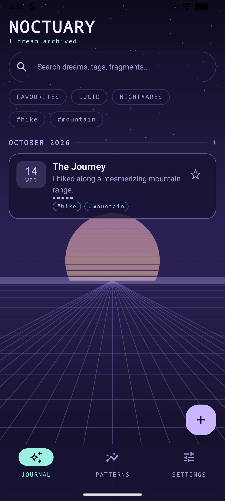
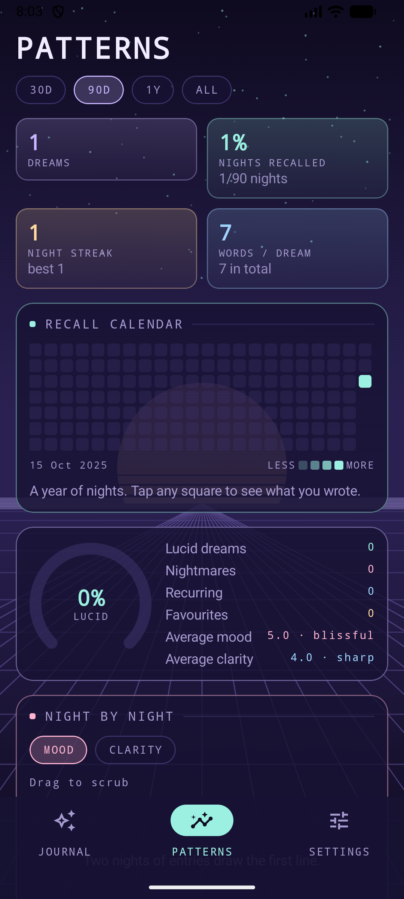
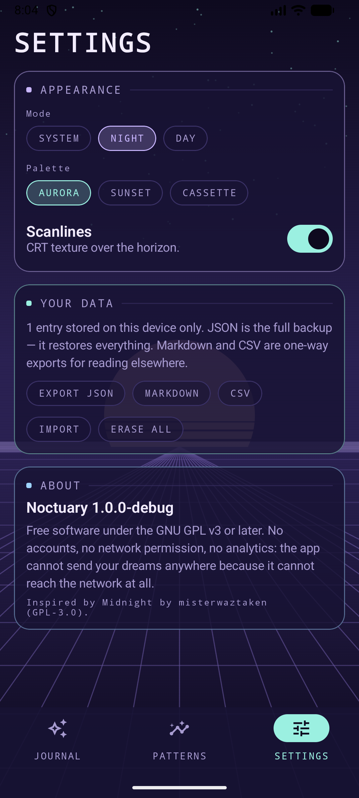

<p align="center">
  
</p>

# Noctuary

A dream journal for Android that keeps everything on your phone and turns a
year of scribbled fragments into something you can actually read.

Inspired by [Midnight](https://github.com/misterwaztaken/midnight) — same
spirit (open it, write your dream, done), with a retrofuturist face and
statistics built for lucid-dreaming practice.

**Kotlin · Jetpack Compose · Room · GPL-3.0-or-later · no network permission**

## Screenshots

<p align="center">
  
  &nbsp;
  
  &nbsp;
  
</p>

---

## Features

**Writing**
- Record a dream in seconds; the title is optional.
- **Choose the night.** The dream date is yours to set when adding *and* when
  editing — tap `LAST NIGHT` / `NIGHT BEFORE` / `2 NIGHTS AGO`, or open the
  calendar. Future dates are not selectable.
- Mark entries lucid, nightmare, recurring or favourite; rate mood and clarity
  1–5.
- Free-form tags, with search and filtering across tags, markers and text.

**Statistics that are worth opening**
- **Recall calendar** — a year of nights as a heatmap. Tap any square to see
  what you wrote that night and jump straight to the entry.
- **Night-by-night trend** — mood or clarity, drag your finger across to scrub;
  the readout follows.
- **Weekday breakdown** — which nights you remember, with lucid nights overlaid
  in mint. Tap a bar for the numbers.
- **Month breakdown**, **lucid-rate dial**, **theme ranking** (tap a tag for its
  mean mood and lucid count).
- **Dream signs** — the words that keep returning across *different* nights,
  counted per-dream so one long entry can't dominate. These are exactly what
  lucid-dreaming practice tells you to notice.
- Recall rate, current and longest streak, words per dream.
- Everything recomputes over 30 days / 90 days / 1 year / all time.

**Your data**
- **Export**: JSON (complete, restorable backup), Markdown, or CSV. Written via
  the system file picker, so it lands wherever you choose — no storage
  permission needed.
- **Import**: JSON, either **merge** (skips entries that look identical, so
  re-importing is harmless) or **replace**. The parser is deliberately lenient
  and will usually read exports from other dream journals: it recognises common
  field names (`date`/`dreamDate`/`timestamp`, `body`/`content`/`text`,
  `starred`/`favorite`, …) and epoch days, seconds or milliseconds.
- Dates are stored as epoch **days**, so entries never shift when you change
  timezone, and exported as ISO strings so a backup stays readable in ten years.

**Look**
- Synthwave horizon with a drifting perspective grid, pastel sun and optional
  CRT scanlines, drawn in Compose — no images, no bundled fonts.
- Three pastel palettes (Aurora, Sunset, Cassette), each in night and day mode,
  plus follow-system.

## Build

```bash
git clone https://github.com/AgentGit007/noctuary.git
cd noctuary
./gradlew assembleDebug
# → app/build/outputs/apk/debug/app-debug.apk
```

Requirements: JDK 17, Android SDK 35. Opening the folder in Android Studio
(Ladybug or newer) also works — everything is declared in
`gradle/libs.versions.toml`.

### Before you release

1. The application ID is `io.github.agentgit007.noctuary`, derived from the
   GitHub account that hosts the source, as F-Droid recommends. If you move the
   project, change it in `app/build.gradle.kts` (`namespace` and `applicationId`)
   and rename the package directories under `app/src/main/java/` to match.
2. Bump `versionCode` / `versionName` for each release.

## F-Droid

The project is built to satisfy F-Droid's inclusion policy:

| Requirement | How this project meets it |
| --- | --- |
| FLOSS licence | GPL-3.0-or-later (`LICENSE`) |
| No proprietary dependencies | AndroidX, Compose, Room and kotlinx-serialization only — all from Google Maven / Maven Central, both trusted repos under the policy. No Play Services, no Firebase, no Crashlytics, no ad or analytics SDK |
| Buildable from source | Plain Gradle + wrapper, no prebuilt binaries in the tree, no API keys |
| Reproducibility | release builds set `vcsInfo { include = false }`, which F-Droid's reproducible-builds page recommends when you can't guarantee the APK was built from a clean tree at the tagged commit; `dependenciesInfo { includeInApk = false }` additionally drops the opaque Google-signed dependency blob (not an F-Droid rule, but one less non-source artefact in the APK) |
| No tracking | `AndroidManifest.xml` declares **no permissions at all** — the app cannot open a socket |
| Store listing | `fastlane/metadata/android/en-US/` (title, descriptions, changelog) |
| Assets | Launcher icon is a vector drawn in this repo; no bundled fonts, so no font licence travels with the app |

To submit it, open a merge request against
[fdroiddata](https://gitlab.com/fdroid/fdroiddata) with a metadata file for your
application ID. Add screenshots to
`fastlane/metadata/android/en-US/images/phoneScreenshots/` and an `icon.png`
before submitting — F-Droid picks them up automatically.

Sources: [F-Droid Inclusion Policy](https://f-droid.org/en/docs/Inclusion_Policy/) ·
[F-Droid Reproducible Builds](https://f-droid.org/en/docs/Reproducible_Builds/)

## Project layout

```
app/src/main/java/io/github/agentgit007/noctuary/
├── MainActivity.kt            entry point, theme host
├── NoctuaryApplication.kt     container: database + settings
├── NoctuaryViewModel.kt       single app-scoped state holder
├── data/                      Room entity, DAO, database, repository, settings
├── stats/DreamStats.kt        pure-Kotlin statistics engine (no Android deps)
├── backup/BackupFormat.kt     JSON/Markdown/CSV export, lenient JSON import
└── ui/
    ├── theme/                 three palettes × night/day, typography, shapes
    ├── components/            retro backdrop, glass cards, pills, tiles
    ├── journal/               list, search, filters
    ├── editor/                entry editor with the date picker
    ├── stats/                 charts (Compose Canvas) + statistics screen
    ├── settings/              appearance, export/import, about
    └── nav/                   navigation and scaffold
```

Charts are drawn by hand on a Compose `Canvas` rather than pulled from a chart
library: fewer dependencies for F-Droid to vet, and the pastel palette applies
to the statistics as well as the chrome.

## Licence

GNU General Public License v3.0 or later. See [LICENSE](LICENSE).

Midnight, the app that inspired this one, is also GPL-3.0 — no code was copied
from it; the lineage is in the idea and the restraint.
